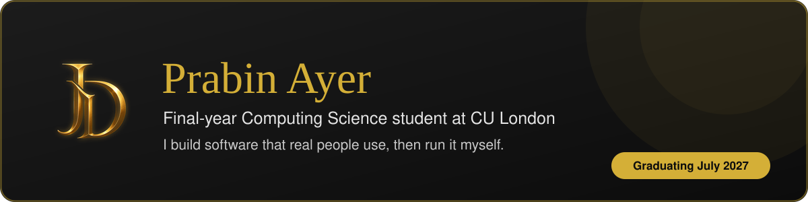

  

  
  
  

I'm a final-year **BSc Computing Science** student at CU London (First Class average at Level 5), graduating in July 2027. Most of what I know comes from running my own platform for real players: shipping releases, answering support messages and fixing live data when something breaks.

**Looking for:** 2027 graduate software engineering roles in the UK.

## Live in production

### [JD Esports Arena](https://jdesport.co.uk) &nbsp;·&nbsp; [code](https://github.com/AyerPrabin/jd-esports-arena)

A Free Fire tournament platform for players in Nepal with **450+ registered players**. Events, a points wallet with eSewa loads and payouts, Clash Squad challenges, moderator and admin tools, and an Android app. **JD Admin**, an under-30 KB native Android app, forwards eSewa and Khalti "money received" alerts so mods can approve point loads in seconds.

## Smaller projects

| Project | What it is | CI |
| --- | --- | --- |
| **[jd-ledger](https://github.com/AyerPrabin/jd-ledger)** | A points-wallet ledger in Python and PostgreSQL, built on how my platform's wallet works. Append-only history, idempotent transfers, refund-once rules and ordered row locks, behind a token-secured FastAPI API. 61 tests, including 50 parallel transfers and property-based tests. |  |
| **[jd-points-table](https://ayerprabin.github.io/jd-points-table/)** | A React + TypeScript app for scoring squad events on a phone: placement and kill points, tie-breaks, and a way to handle a lost match result. 95 Vitest tests and a Playwright end-to-end test. |  |
| **[jd-fair-play](https://github.com/AyerPrabin/jd-fair-play)** | Flags unusual squad results in Free Fire events for a moderator to review: robust-statistics rules first, an Isolation Forest second, each flag with a plain-English reason. Evaluated on a seeded synthetic set; 99 tests. |  |
| **[jd-stats-api](https://github.com/AyerPrabin/jd-stats-api)** | A read-only REST API for my tournament results. FastAPI, plain SQL on SQLite, 32 tests and a non-root Docker image. |  |
| **[jd-arena-insights](https://github.com/AyerPrabin/jd-arena-insights)** | SQL analysis of my platform's growth from anonymised totals. Signups went from 102 days for the first 100 players to 5 days per 100 by November. |  |
| **[SafeStep](https://ayerprabin.github.io/SafeStep/)** | A browser game that teaches cyber security through 15 hands-on missions. | |
| **Jay Durge Automobiles ERP** (private) | The operations system for my family's TVS dealership and workshop in Nepal: job cards, sales, stock, customer dues, payroll and SMS service reminders. TypeScript, Express, PostgreSQL, React. Walkthrough on request. | |
| **[CPU benchmarks](https://github.com/AyerPrabin/CPU-GPU-Performance-Benchmark.py)** | Python multiprocessing against sequential runs, with speedup and parallel efficiency. | |

## Tools I use

I work with AI coding assistants, and I check, test and ship what goes live myself.

📫 [LinkedIn](https://linkedin.com/in/ayerprabin) · [Portfolio](https://ayerprabin.github.io/prabin-ayer-portfolio/) · ayerprabin95@gmail.com
